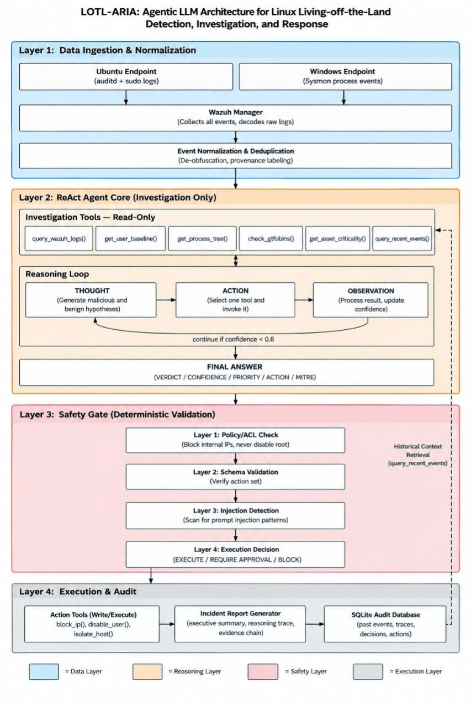
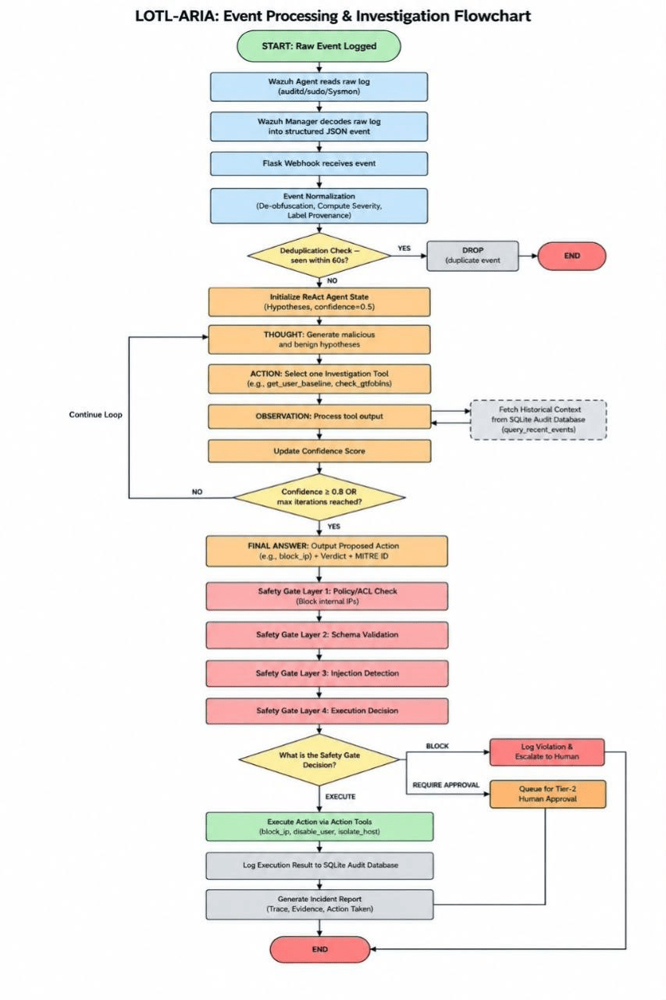

# 🛡️ LOTL-ARIA: Agentic LLM Framework for LOTL Attack Investigation

> **Status:** 🚧 **Work in Progress (Semester 1 - Layers 1 & 2)** 🚧
> *This project is currently under active development as part of our Bachelor's graduation thesis.*

**LOTL-ARIA** (Agentic Response and Investigation for Attacks) is an autonomous cybersecurity framework that bridges the gap between passive Machine Learning detectors and active, investigating LLM agents. It specifically targets **Linux Living-off-the-Land (LOTL)** attacks.

Instead of relying on rigid rules or black-box ML models, LOTL-ARIA uses a **ReAct (Reasoning + Acting)** LLM agent to investigate raw system events (from `auditd` and `sudo` logs), form dual hypotheses (malicious vs. benign), and propose a graded response. 

To ensure safety, all agent actions will eventually pass through a **Multi-Layer Deterministic Safety Gate** to prevent prompt injection attacks (Planned for Semester 2).

## 📖 Documentation
- [Download/View the Research Paper](https://github.com/OmarTanah/Agentic-AI-Security-Supervisor-LOTL/raw/main/docs/research_paper.pdf)
- [Download the Seminar Presentation (PPTX)](https://github.com/OmarTanah/Agentic-AI-Security-Supervisor-LOTL/raw/main/docs/seminar1_presentation.pptx)

## 🏗️ Architecture
*(The following diagrams illustrate the target architecture for the completed project)*

### System Architecture


### Process Flowchart


## 🚀 Current Progress
- [x] Literature Review (11 recent papers)
- [x] Identification of 3 Core Research Gaps (Context, Response, Safety)
- [x] System Architecture & Flowchart Design
- [x] **Layer 1: Data Ingestion & Normalization** (Completed)
  - Wazuh integration (raw log forwarding)
  - Multi-layer De-obfuscation (Base64, Hex, ANSI-C)
  - Heuristic Severity Scoring
  - SQLite Audit Database & Deduplication
  - Asynchronous Flask Webhook (Threading)
  - Dynamic GTFOBins Filtering (Drops benign noise)
- [x] **Layer 2: ReAct Agent Core** (Completed)
  - LangGraph State Machine (Thought → Action → Observation)
  - LLM Integration (Groq & Gemini Fallback Chain)
  - **Hybrid GTFOBins Tool:** RapidFuzz payload matching + capability checking
  - **Baseline Tool:** SQLite historical user context
  - **Process Tree Tool:** `psutil` live process lineage
  - **Wazuh Log Query Tool:** Elasticsearch/SQLite contextual lookups
  - Evaluation Script (Precision, Recall, F1-Score generation)
- [ ] **Layer 3: Deterministic Safety Gate** (Planned for Semester 2)

## 🛠️ Investigation Tools
The ReAct agent uses the following read-only tools:
1.  **`check_gtfobins(binary, command)`**: Compares the live command against known GTFOBins payloads using RapidFuzz.
2.  **`get_user_baseline(username, binary)`**: Checks SQLite for anomalies in user behavior.
3.  **`get_process_tree(command, pid)`**: Uses `psutil` to identify suspicious parent processes.
4.  **`query_wazuh_logs(query)`**: Queries the Wazuh Indexer (with SQLite fallback) for deeper context.

## ⚙️ How to Run (Full Prototype)

### 1. Prerequisites
- Python 3.10+
- Wazuh Manager installed and configured to forward events to `archives.json`.
- A Groq API Key (Primary) and/or Google Gemini API Key (Fallback).

### 2. Installation
1. Clone the repository:
   ```bash
   git clone https://github.com/OmarTanah/Agentic-AI-Security-Supervisor-LOTL.git
   cd Agentic-AI-Security-Supervisor-LOTL
   ```
2. Create a virtual environment and install dependencies:
   ```bash
   python3 -m venv .venv
   source .venv/bin/activate
   pip install -r requirements.txt
   ```

### 3. Environment Variables
Create a `.env` file in the root directory:
```text
GROQ_API_KEY=your_groq_key_here
GOOGLE_API_KEY=your_gemini_key_here
```

### 4. Running the Pipeline (3 Terminals)
**Terminal 1: Start the Flask Webhook (Layer 1)**
```bash
python -m src.layer1.webhook
```

**Terminal 2: Start the Wazuh Log Forwarder**
```bash
sudo .venv/bin/python src/wazuh_forwarder.py
```

**Terminal 3: Trigger a Test Attack**
```bash
sudo find /var/log -name "*.log" -exec /bin/ls {} \;
```
*Watch Terminal 1 to see the Agent's investigation loop and final verdict!*

### 5. Running Tests & Evaluation
Run the unit tests:
```bash
pytest tests/layer2/ -v
```

Run the evaluation dataset (generates Precision, Recall, F1-Score):
```bash
python scripts/evaluate.py
```

## 👥 Team
- **Omar Tanah**
- **Louay Almarri**
- **Hamza Beirouti**

**Supervisors:** Dr. Waseem Juneidi, Eng. Ahmad Shekha
**Institution:** Syrian Private University - Faculty of Artificial Intelligence Engineering
```
